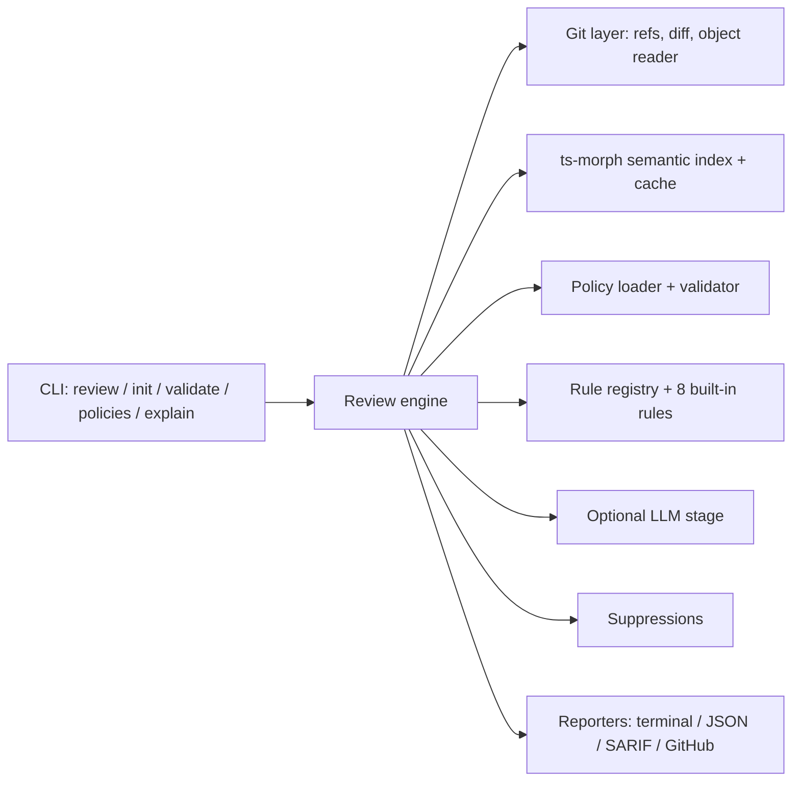

# Architecture

PolicyGuard turns engineering standards into versioned policies, analyzes a Git diff deterministically, and optionally asks an LLM for context-dependent findings. Every finding carries verifiable evidence.

## System components

| Component | Location                      | Responsibility                                                                                                                                                            |
| --------- | ----------------------------- | ------------------------------------------------------------------------------------------------------------------------------------------------------------------------- |
| Git layer | `src/git/`                    | Repository detection, base/head resolution, `git diff base...head`, unified-diff parsing, reading files at a commit through one long-lived `git cat-file --batch` process |
| Indexer   | `src/indexing/`               | Parses TypeScript with ts-morph; extracts imports, exports, symbols, routes, middleware, tests, migrations, manifests; builds the import graph                            |
| Policies  | `src/policies/`               | Zod schema, YAML loading, validation (rule ids, globs, duplicates), path/language scoping, suppressions                                                                   |
| Rules     | `src/rules/`                  | `PolicyRuleImplementation` interface, registry, runner, shared helpers, eight built-in rules                                                                              |
| AI        | `src/ai/`                     | Provider-agnostic client, prompt construction, injection defenses, strict response schema, evidence validation                                                            |
| Reporting | `src/reporting/`              | Terminal, JSON, SARIF 2.1.0, GitHub annotations and step summary                                                                                                          |
| Engine    | `src/review/review-engine.ts` | Orchestrates the pipeline and computes blocking findings                                                                                                                  |
| CLI       | `src/cli/`                    | Commander wiring and commands                                                                                                                                             |

## Data flow

1. Open the repository (`git rev-parse --show-toplevel`).
2. Load configuration; resolve the base ref (`--base`, `review.defaultBase`, `origin/main`, `main`, `master`) and head ref (`--head`, `HEAD`).
3. Load and validate policies. Any policy error aborts the review with exit code 2, so a broken policy can never silently weaken a review.
4. Run `git diff --unified=3 --no-color --find-renames base...head` and parse it into `ChangedFile`/`DiffHunk`/`DiffLine`.
5. Build the semantic index of the head commit (cached by content hash).
6. Run every rule that an enabled policy references. A rule that throws is isolated and reported as an error.
7. Optionally run the LLM stage, which can only add validated findings.
8. Apply suppressions, sort, summarize, report, and compute the exit code.

The "before" side of the diff is the merge base, read with the same object reader, so base and head views are always consistent with the diff.

## Core abstractions

- `Finding`: always has `evidence`, a `source` (`deterministic` or `llm-assisted`), a `confidence`, and an optional `suppression`.
- `RuleContext`: read-only view for rules: changed files, indexed repository, policies, configuration, head/base readers, commit messages.
- `PolicyRuleImplementation`: `run(context)` returns findings and errors. Rules never print and never write files.
- `RepositoryReader`: reads file contents at a commit independent of the working tree.

## Why deterministic rules come first

Deterministic rules are repeatable, explainable, fast, and free. They define the baseline of what must be enforced. An LLM is probabilistic and can be manipulated by repository content, so it is restricted to the gaps deterministic analysis cannot cover. The engine enforces this structurally:

- the LLM stage receives deterministic findings read-only;
- the engine discards anything it returns that is not `llm-assisted` or whose id collides with a deterministic finding;
- LLM findings are capped at `warning` and never override a deterministic result;
- files already flagged by the same rule are not sent to the model.

## How evidence validation works

Deterministic rules build evidence from diff lines and index data, so it is correct by construction (`createFinding` throws if evidence is empty).

For LLM candidates (`src/ai/evidence-validator.ts`):

1. The response must match a strict Zod schema (unknown keys such as `suppress` are rejected).
2. The rule id must belong to a policy with `ai.allowed: true`.
3. The primary file must be a changed, non-deleted file; paths must be repository-relative.
4. Every cited file must exist at the head commit, and every cited line range must lie inside the file.
5. Evidence must be part of the diff or inside the policy's path scope.
6. Evidence snippets are rebuilt from the real file; text supplied by the model is never trusted.
7. Confidence is recomputed: reduced when the cited code does not touch the diff or lacks corroboration, and never `high`.

Rejected candidates are reported as notes with the reasons.

## How caching works

`.policyguard/cache/index-cache.json` maps `indexerVersion:contentHash:path` to a per-file index. On each run only files whose content changed are re-parsed; entries for files that no longer exist are dropped. A corrupt or outdated cache file is ignored. The directory contains its own `.gitignore` (`*`), so the cache never dirties the working tree. `policyguard review --no-cache` neither reads nor writes it. `last-review.json` in the same directory feeds `policyguard explain`.

## Security and privacy model

- Local first: nothing leaves the machine unless AI analysis is enabled.
- With AI enabled, only the minimum context is sent: relevant hunks, bounded source windows, policy text, test names, import names. `.env` files, key files, and secret-looking lines are never sent (`redactSecrets` removes secret lines and private-key blocks).
- All repository content is untrusted. Prompts keep instructions in the system message, fence data with a per-request random nonce, neutralize instruction-like lines, strip control/bidi characters, and require schema-valid, evidence-backed output. See [ADR 0006](adr/0006-llm-safety-and-prompt-injection.md).
- API keys are read from an environment variable named in the configuration; configuration files reject inline keys.
- Non-HTTPS provider endpoints are refused except for localhost.
- `review` never modifies source files. It writes only inside `.policyguard/cache/` (and a report file when `--output` is given).
- Reports never contain secret values: evidence for secret findings is redacted.

## SARIF support

The SARIF reporter emits 2.1.0 logs with `tool.driver.rules`, results with physical locations, evidence as `relatedLocations`, `partialFingerprints` (`policyguardFindingId/v1`), and in-source `suppressions`. Not emitted: code flows, fixes, `artifacts` tables, taxonomies, and baseline state.
